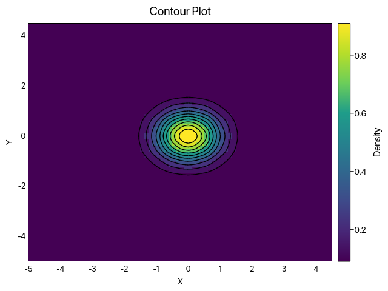
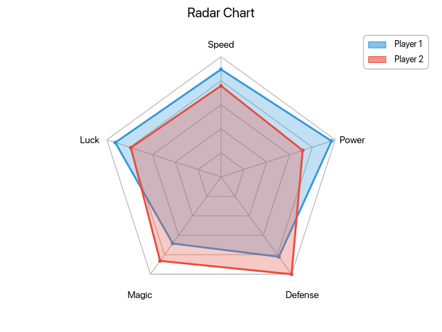
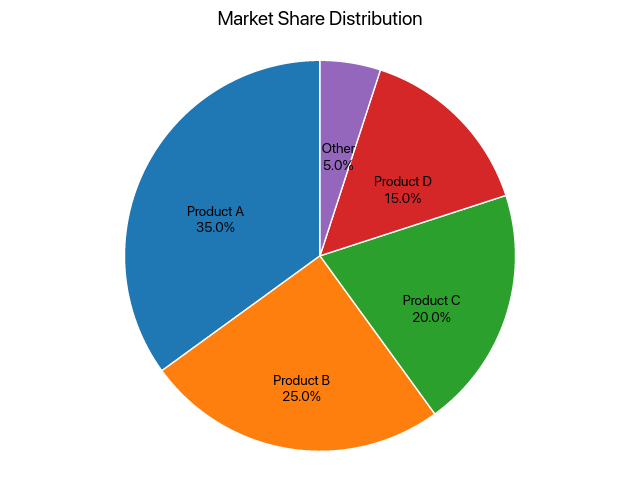
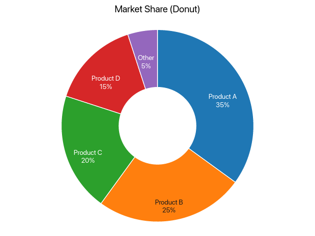
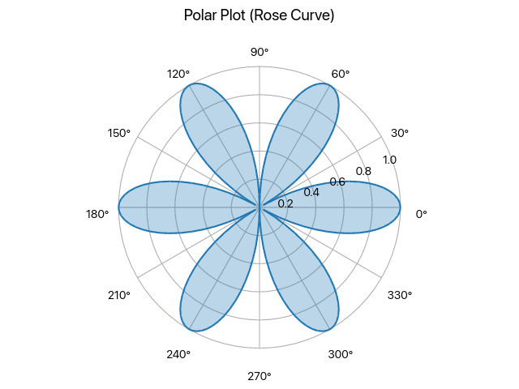
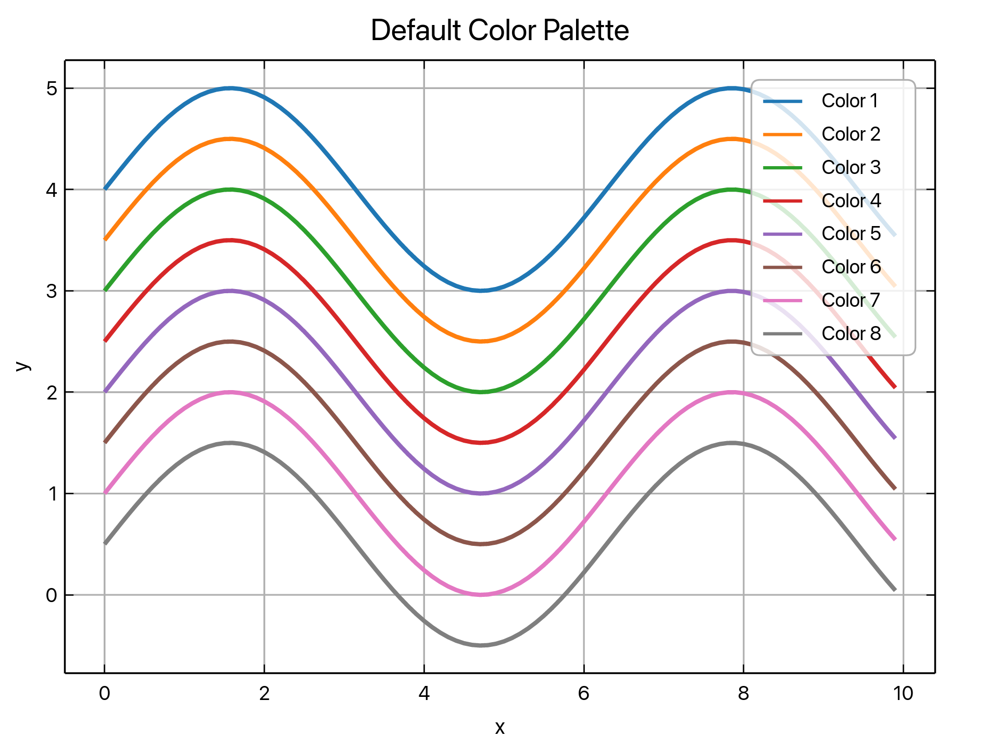
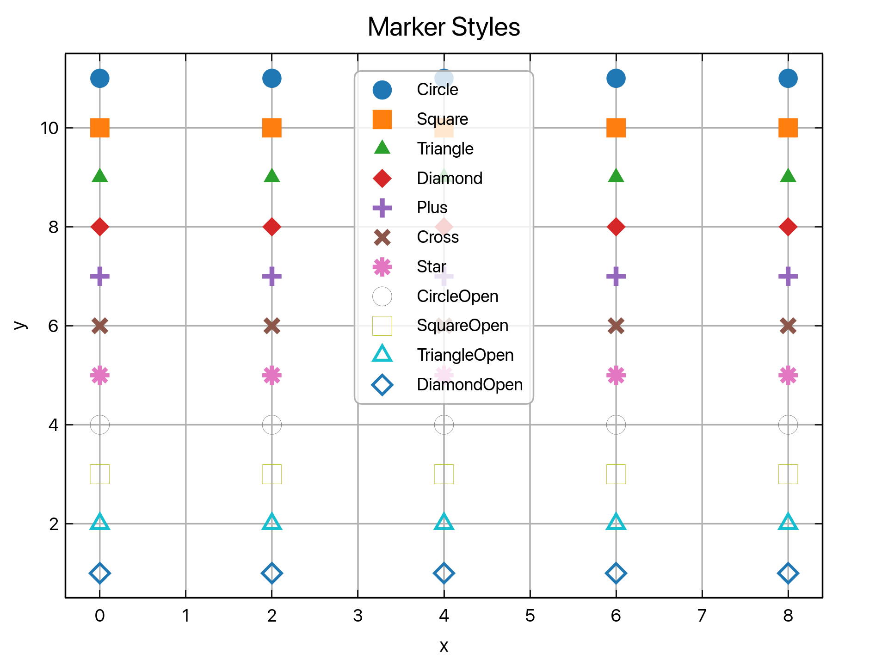
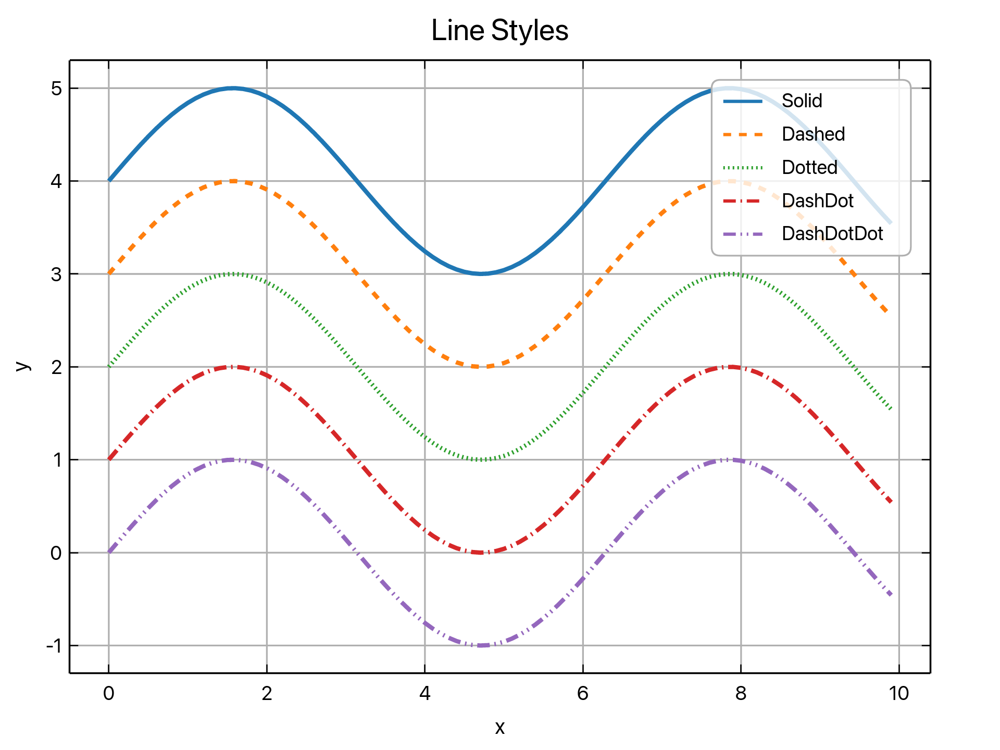
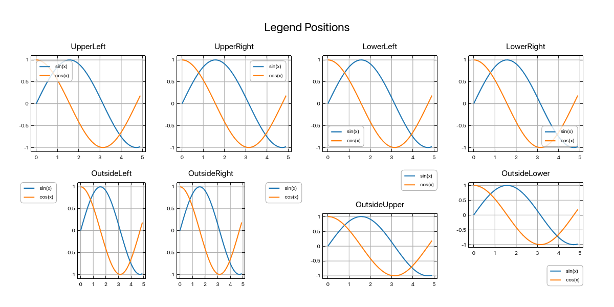

# Advanced Techniques

Styling, polar/radar, and layout-heavy visualizations.

## Examples

### Contour Plot

Contour rendering example with level interpolation.

Source: [examples/doc_contour.rs](../../../examples/doc_contour.rs)

### Complex-Function Magnitude

A sampled Butterworth magnitude field with logarithmic grayscale, a colorbar, and pole overlays.

Source: [examples/complex_function.rs](../../../examples/complex_function.rs)

Guide: [Images & Complex Functions](../../guide/15_image_plots.md)

### Complex-Function Domain Coloring

Caller-defined RGBA colors encode phase and magnitude with equal data aspect and line/scatter overlays.

Source: [examples/complex_function.rs](../../../examples/complex_function.rs)

Guide: [Images & Complex Functions](../../guide/15_image_plots.md)

### Radar Chart

Radar chart example demonstrating non-cartesian layout support.

Source: [examples/doc_radar.rs](../../../examples/doc_radar.rs)

### Pie Chart

Composition shares with labels and percentages.

Source: [examples/doc_pie.rs](../../../examples/doc_pie.rs)

### Donut Chart

A pie chart variant with a central cutout.

Source: [examples/doc_pie.rs](../../../examples/doc_pie.rs)

### Polar Rose

A filled polar line plot for non-cartesian data.

Source: [examples/doc_polar.rs](../../../examples/doc_polar.rs)

### Color Palette

Default palette reference across multiple line series.

Source: [examples/doc_colors.rs](../../../examples/doc_colors.rs)

### Marker Styles

Reference image covering filled and open marker variants.

Source: [examples/doc_marker_styles.rs](../../../examples/doc_marker_styles.rs)

### Line Styles

Reference image covering solid, dashed, and dotted lines.

Source: [examples/doc_line_styles.rs](../../../examples/doc_line_styles.rs)

### Legend Positions

Reference image covering legend placement options.

Source: [examples/doc_legend_positions.rs](../../../examples/doc_legend_positions.rs)

[← Back to Gallery](../README.md)
