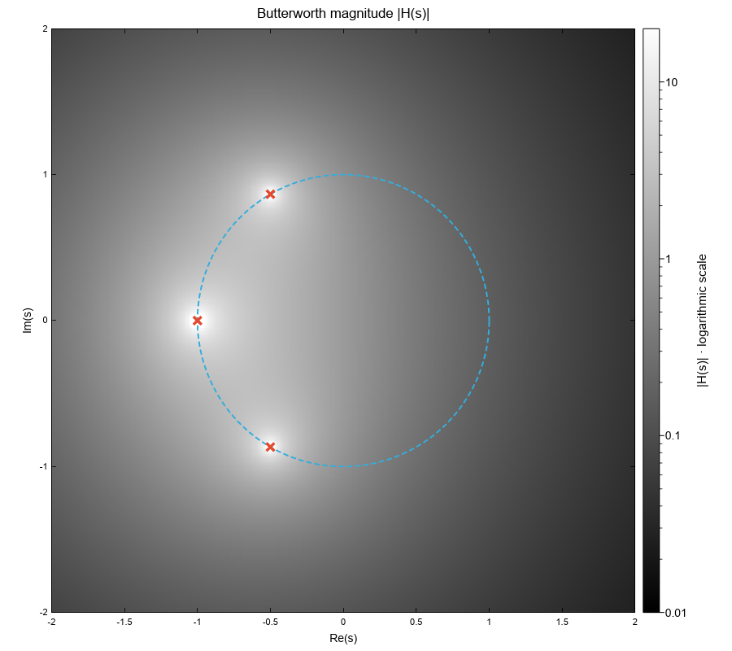
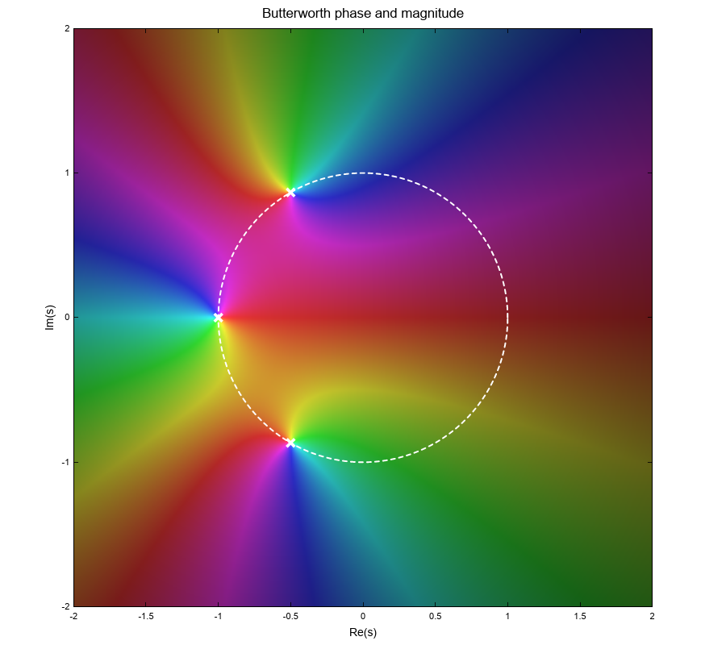

# Images and complex-function plots

Use `Plot::image` for colors you have already calculated and `Plot::heatmap` for
scalar values that Ruviz should normalize and map to a colormap. Both fit within
normal axes and support line and scatter overlays.

| Input | Builder | Color interpretation |
| --- | --- | --- |
| Rows of scalar values | `heatmap(&rows)` | Colormap, value scale, and optional colorbar |
| Straight-alpha RGBA bytes | `image(&image)` | Explicit pixel colors and opacity |
| Scalar function on a regular grid | `heatmap_fn(width, height, extent, f)` | Same as `heatmap` |
| Color function on a regular grid | `image_fn(width, height, extent, f)` | Same as `image` |

## Place an RGBA image in data coordinates

`Image` stores four bytes per pixel in RGBA order. Rows are contiguous, with each
row running from left to right. RGB channels use straight alpha: a half-opaque
red pixel is `[255, 0, 0, 128]`.

```rust,check
use ruviz::prelude::*;

fn main() -> ruviz::core::Result<()> {
    let image = Image::new(2, 2, vec![
        255, 0, 0, 255,   0, 255, 0, 255,
        0, 0, 255, 255,   255, 255, 0, 128,
    ]);

    Plot::new()
        .image(&image)
        .extent(-1.0, 1.0, -1.0, 1.0)
        .origin(ImageOrigin::Lower)
        .interpolation(ImageInterpolation::Nearest)
        .alpha(0.9)
        .line(&[-1.0, 1.0], &[0.0, 0.0])
        .color(Color::BLACK)
        .data_aspect(1.0)
        .save("rgba_image.png")?;
    Ok(())
}
```

An extent describes the **outer pixel edges**, as `(xmin, xmax, ymin, ymax)`.
Without an explicit extent, an image occupies `(0, width, 0, height)`; pixel
centers are half a source pixel inside those edges. Dimensions must be nonzero,
the buffer must contain exactly `width × height × 4` bytes, and extent edges must
be finite and strictly increasing with finite spans. Builder validation errors are returned by
terminal operations such as `render`, `save`, and `render_to_svg`.

`ImageOrigin::Upper`, the default, puts row zero next to `ymax`.
`ImageOrigin::Lower` puts it next to `ymin`. Origin describes physical placement
independently of axis display direction: `invert_y()` or descending `ylim`
limits reverse the view without changing the source's origin. Extents themselves
stay increasing when either displayed axis is reversed.

Nearest interpolation preserves individual pixel colors. Bilinear interpolation
smooths between pixel centers in premultiplied-alpha space, so fully transparent
pixels do not introduce color fringes. Source pixel opacity and the builder's
`.alpha(...)` multiply. Images are clipped to the axes, and later series draw
over earlier ones.

For reusable settings, pass an `ImageConfig` to `image_with`:

```rust,check
use ruviz::prelude::*;

fn main() -> ruviz::core::Result<()> {
    let image = Image::new(1, 1, vec![40, 120, 220, 255]);
    let config = ImageConfig::new()
        .extent(-2.0, 2.0, -1.0, 1.0)
        .origin(ImageOrigin::Lower)
        .interpolation(ImageInterpolation::Bilinear);
    Plot::new().image_with(&image, config).save("configured_image.png")?;
    Ok(())
}
```

## Sample a function once

The function helpers take an explicit source grid and data extent. For column
`i` and row `j`, the callback receives:

```text
x = xmin + (i + 0.5) × (xmax − xmin) / width
y = ymin + (j + 0.5) × (ymax − ymin) / height
```

Sampling runs eagerly in row-major order, starting at the lower physical edge,
and the resulting series uses lower origin. A valid grid invokes the callback
exactly `width × height` times during the helper call. Rendering at another DPI,
exporting again, or changing the viewport uses the stored samples. Choose a new
source resolution and build another series to evaluate the function more finely.

```rust,check
use ruviz::prelude::*;

fn main() -> ruviz::core::Result<()> {
    Plot::new()
        .heatmap_fn(200, 160, (-2.0, 2.0, -1.6, 1.6), |x, y| {
            (-x * x - y * y).exp()
        })
        .cmap("viridis")
        .colorbar_label("exp(−x² − y²)")
        .data_aspect(1.0)
        .save("sampled_scalar.png")?;

    Plot::new()
        .image_fn(200, 160, (-2.0, 2.0, -1.6, 1.6), |x, y| {
            let red = ((x + 2.0) / 4.0 * 255.0) as u8;
            let blue = ((y + 1.6) / 3.2 * 255.0) as u8;
            Color::from_rgba(red, 80, blue, 255)
        })
        .data_aspect(1.0)
        .save("sampled_rgba.png")?;
    Ok(())
}
```

The callback can capture mutable state. Ruviz does not choose complex arithmetic,
pole handling, magnitude clipping, phase colors, or missing-value policy for
you. Return `NaN` for a missing scalar heatmap sample or alpha zero for a missing
RGBA image sample.

## Keep mathematical geometry proportional

`.data_aspect(1.0)` gives one x data unit and one y data unit the same displayed
length on linear axes. A unit circle remains circular even when the figure is
rectangular or a heatmap reserves room for a colorbar. The setting fits the axes
rectangle inside the available layout while preserving the resolved data limits.
Without it, axes use the available space automatically. `.aspect_equal()` is a
shorthand for `.data_aspect(1.0)`. A ratio of `2.0` gives a y unit twice the
displayed length of an x unit. For nonlinear axes, units are measured after
transformation: one decade for logarithmic axes, or the symmetric-log coordinate.
Invalid ratios and geometry too narrow to represent produce a rendering error.

PNG output samples the source into the output axes rectangle. SVG embeds that
image as a PNG while retaining vector axes and overlays, and is available without
the `3d` feature. PDF uses the same image path with the `pdf` feature enabled.

## Reproduce the Butterworth example

Run this command from the repository root:

```sh
cargo run --example complex_function
```

The [example source](../../examples/complex_function.rs) evaluates the
third-order Butterworth function `H(s) = 1 / (1 + 2s + 2s² + s³)` on a
320 × 320 grid. The grayscale view clips `|H(s)|` to `[0.01, 20]` and uses a
logarithmic heatmap color scale. Its scalar colorbar retains the numerical meaning
of the shading. The dashed unit circle and the three pole crosses use ordinary
line and scatter series.



The second view computes explicit RGBA colors: hue represents phase, with red at
phase zero, and brightness increases with clipped logarithmic magnitude. Because
the colors encode two quantities, the image does not add a scalar colorbar.



The example saves both images under `generated/examples/complex_function/`.
`make rust-gallery` publishes these outputs to the committed gallery above.
